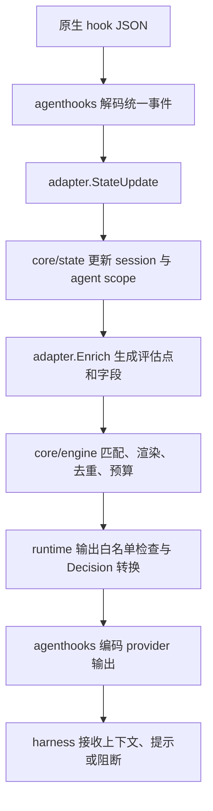

# STYLE 当前 adapter 实现总览

更新时间：2026-10-18。M3 已按确认范围完成并关闭，见[最终报告](review/M3-FINAL-2026-10-18.json)及[文档关闭核对](review/M3-DOCS-01-2026-10-18.json)。D0–D11、T00–T80/A0–A18、两家各三条本地真实路线、本地 exact、最终三平台 CI 和旧版本兼容均通过；源码与二进制摘要逐报告固定。用户延期的 C3、W1 和 Anthropic 独立 API 保持待验，官方校准各0/40仍非阻塞。范围、状态和隔离步骤见[M3 任务](STYLE-M3-TASKS.md)、[测试矩阵](STYLE-M3-TESTS.md)、[手册](STYLE-M3-MANUAL.md)。

M1/M2 保持只读历史，M2 native/stats/去重/rules/replace 与真实验收事实继续有效。用户延期 C3 托管云端、W1 实际 Windows harness 和 Anthropic 独立 API；官方校准两家各0/40继续非阻塞。本地 exact 编码不替代官方模型校准。文中历史 provider 字段仍表示 harness，新的 when.provider 则表示模型服务配置请求。

agenthooks 保留协议、事件、原生输出、配置渲染、owner/信任合并与文件事务职责；adapter 提供平台/数据/能力事实，core 保持通用匹配、预算和状态。M3 已移除名称校验白名单及 engine 的具体 Claude 输出分支，分别由注册表目录和输出能力替代。

本文总结当前仓库的实现，不代表 Claude Code / Codex 所有版本的完整产品能力。能力声明、安装配置、运行时可接收事件和真实验收结果分别说明；未修改现有 fallback 语义。

## 1. 范围与职责

STYLE 当前完整接入两个 provider：`codex` 和 `claude-code`。`agenthooks` 虽然还有其他 provider 的 codec / renderer，STYLE 尚未为它们提供完整 adapter 和 CLI 运行时接线。

| 层 | 负责内容 | 主要入口 |
|---|---|---|
| `agenthooks` | 原生输入解码、统一事件、工具/MCP/skill 识别、Decision 编码、hook 配置生成和 owner 合并 | [codec](../agenthooks/codec_codex.go)、[Claude codec](../agenthooks/codec_claudecode.go)、[install](../agenthooks/install/install.go) |
| `internal/adapter` | provider 检测、能力与数据来源声明、静态槽位、安装路线、原生数据补充 | [types.go](../internal/adapter/types.go) |
| `core/plan` | 根据规则需求和 adapter 事实选择投递位置，决定降级、跳过和安装错误 | [plan.go](../core/plan/plan.go) |
| `core/compile` | 把规划结果编译为 index 和静态正文 | [目录](../core/compile/) |
| `core/engine`、`core/state` | 匹配、渲染、去重、预算、会话和 agent 状态 | [engine](../core/engine/)、[state](../core/state/) |
| `internal/runtime` | 串起 codec、adapter、state、engine 和输出决策 | [runtime.go](../internal/runtime/runtime.go) |
| `internal/source` | 显式 Git 来源、固定 OID 原始导出及私有完整缓存；仅管理冷路径 | [git.go](../internal/source/git.go)、[cache.go](../internal/source/cache.go) |
| `internal/app` | 安装、卸载、sync/trust、lock 1/2 及项目 lock 3 与批准身份、共享提交保护、路线选择、报告、CLI hook 入口 | [install.go](../internal/app/install.go)、[hook_command.go](../internal/app/hook_command.go) |

原则是 adapter 提供事实，core 决定策略。`core` 不导入 `agenthooks` 或 `internal/adapter`，由 [边界测试](../internal/adapter/boundary_test.go) 检查。

## 2. 公共接口与注册

[Definition](../internal/adapter/types.go) 将一个 provider 组装成以下部分：

| 接口或字段 | 作用 |
|---|---|
| `Detector.Detect` | 只读检测安装、版本与配置目录，返回 `Installation` |
| `PlanningFacts.Capability` | 某评估点是否支持 `add-context`、`system-message`、`deny` |
| `PlanningFacts.DataSource` | 某评估点能否提供条件/模板所需字段，记录来源与近似标记 |
| `PlanningFacts.BlindSpot` | 整条规则是否不可观测；非 fatal reason 说明部分可见性边界 |
| `PlanningFacts.StaticLocation` | `append` / `replace` 是否有可用静态槽位 |
| `NativePlanningFacts` / `NativeWriter` / `Definition.Native` | 分别提供 native 规划事实、命令渲染与合法原生事件；注册表向完整 validate 提供普通名称全集及 native 能力子集 |
| `StaticPositionProvider` | 列出具体安装的静态位置，供报告使用 |
| `Routes` | 安装路线及其优先级，声明顺序保留 |
| `Limits` | 原生输入限制、计量单位、是否近似和外部超限行为 |
| `Compact` | 压缩信号及其延迟执行属性 |
| `RuntimeEnricher.StateUpdate` | 将事件中的 model、effort、来源等转换成状态更新 |
| `RuntimeEnricher.Enrich` | 将统一事件转换为 `engine.Input` 和本次输入限制 |

`RuntimeEnricher` 单独定义，没有直接存入 `Definition`。CLI 的 `runHook` 按 provider 显式构造具体 `Enricher`；新增 provider 时也要补这一处接线。

[Registry](../internal/adapter/registry.go) 显式构造，没有全局自动注册。它校验 provider/route 名称、必需接口、限制单位与 compact 元数据；provider 枚举排序，route 顺序保留。`BuildPlanAdapter` 将丰富的事实接口投影成 `core/plan.Adapter` 的窄接口。

M3-T00 的 `Registry.ValidationCatalog()` 返回独立的名称 slice 与 native map，Service 构造时保存快照。[`spec.ValidateWithCatalog`](../core/spec/validate.go) 统一检查 `when.harness.name`、`requires.harness`、`recommends` 和 native 映射；名称只看注册，不看本机检测或当前选择。普通注册项可无 native 能力，额外 Native 键不能扩大名称全集，空目录明确拒绝任何显式名称。`spec.Validate(pkg)` 保留签名但只做结构/lint；`Validate + ValidateNative` 也不代表完整有效性。入包/重编译均使用完整入口，预算/去重复用源诊断，core 不从宿主环境或全局名单推导注册项。

## 3. 检测、目录和安装路线

### 3.1 检测

| 项目 | Codex | Claude Code |
|---|---|---|
| 默认配置目录 | `$CODEX_HOME`，否则 `~/.codex` | `$CLAUDE_CONFIG_DIR`，否则 `~/.claude` |
| 可执行文件 | PATH 中的 `codex` | PATH 中的 `claude` |
| 版本读取 | `codex --version` | `claude --version` |
| 配置存在也可作为检测依据 | `config.toml` / `hooks.json` | `settings.json` / `CLAUDE.md` / `rules/` |

检测到配置不等于可执行文件可运行，版本也可能为空。`Installation` 只保存 provider、version、config dir，不保存凭据。

### 3.2 路线

| 路线 | 写入位置与用途 | 信任声明 |
|---|---|---|
| `codex-plugin` | 插件默认在 `$STYLE_HOME/adapters/codex/plugin`；包含插件清单、hook 和指向固定程序的 POSIX 启动器；静态指令及 hook 信任配置仍关联 Codex 配置目录 | `user-confirmation`，不会因文件存在就宣称已信任 |
| `codex-user` | Codex 配置目录的 `hooks.json` 和 `config.toml` | `preseed`，生成 hook 信任状态；配置满足安装检查时可报告 trusted |
| `claude-plugin` | 用户 STYLE_HOME 下本地 marketplace，原生 user scope 手动登记；静态仍在用户 rules | `user-confirmation`，只读元数据状态与实际加载/投递分别判断 |
| `claude-user` | Claude 配置目录的 `settings.json` 和每包 `rules/style-<名字>.md`；重建时迁移旧 `CLAUDE.md` 块 | `workspace`，`Status.Trusted` 保守返回 false，无法从配置文件推断工作区信任 |
| `codex-project` | 显式项目范围的 `R/.codex/hooks.json`，定义哈希信任在用户 CODEX_HOME；静态沿 session.start/compact 降级 | 仍需原生 workspace trust 和规范路径启动，STYLE 不写项目信任 |
| `claude-project` | 显式项目范围的 `R/.claude/settings.json` 与 `R/.claude/rules/style-<名字>.md` | 动态要求根目录启动；文件存在不代表交互 trust 或真实投递 |

POSIX 用户范围的 Codex Definition 声明顺序为 plugin、user，Claude 为 user、plugin；Windows 仅保留对应 user 可用路线。显式 --project 构造仅含对应项目路线的范围。实际选择还受路线参数、已安装锁定信息和可用性影响。项目路线要求已知 Codex >=0.159.3 / Claude >=2.1.301；PATH runner、STYLE_HOME 和 harness 用户配置须与批准绑定一致。Claude 插件路线要求已知 >=2.1.301 与 POSIX shell，默认仍是 user。

Codex 插件的 marketplace 登记/启用尚未由 STYLE 自动完成；已有真实验收采用手动管理命令，不能把生成插件文件等同于 Codex 已加载插件。

示例要求 Codex >=0.159.3、Claude Code >=2.1.300；低/未知版本按既有 schema 跳过且不写配置。自定义包需要自己的版本约束；Codex 固定 Surface 没有独立的按事件版本裁剪表。

### 3.3 文件生命周期

`Route` 提供 `Available`、`Trust`、`Plan`、`Apply`、`Remove`、`Status`。`Plan` / `Remove` 先返回可审阅的 `Changeset`，`Apply` 才写盘。

- `FileChange` 保存路径、根目录、Before/After、权限和删除信息；内容可能包含用户配置，不应直接写进日志。
- 复用 `agenthooks/install` 的 owner 合并、过期快照检查和文件写入；保留外部 handler 与托管区外的字节。
- owner 命名空间为 `style`，静态正文按包分组；卸载一个包后重新编译剩余包，最后一个包卸载时清除 STYLE 路线。
- Codex 的 `TransitionPlanner` 将旧路线移除和新路线生成合并，处理两条路线共享 `config.toml` 的情况。
- 原生 Codex TOML 编辑器可能把手动 marketplace/plugin 表追加进 STYLE 标记内；FINAL-04-FIX 的安装合并/移除会保留这些非 trust 表，损坏区域拒绝写入。临时项目 trust 由 native 写入时单独核对，不能归因于 STYLE 卸载。
- `InstallationBinder` 绑定实际配置目录和版本；`StorageBinder` 绑定选定的 `STYLE_HOME`，使 hook 使用安装时的 index/state。
- [HookCommand](../internal/adapter/command.go) 将 `./style` 等相对路径转成绝对路径；裸命令 `style` 仍交给 PATH 查找。

源码：[Codex route](../internal/adapter/codex/route.go)、[Claude route](../internal/adapter/claude/route.go)。

## 4. 注入点与输出能力

下表是 **STYLE adapter 的能力声明**。`C` 为给模型追加上下文，`U` 为给用户的 `systemMessage`，`D` 为阻断。

| STYLE 评估点 | Codex 原生入口 | Codex 能力 | Claude 原生入口 | Claude 能力 |
|---|---|---|---|---|
| `session.start` | `SessionStart` | C | `SessionStart` | C、U |
| `prompt.submitted` | `UserPromptSubmit` | C、U、D | `UserPromptSubmit` | C、U、D |
| `skill.explicit` | `UserPromptSubmit` 中识别 `$name` | C、U、D | `UserPromptExpansion` | C、U、D |
| `tool.pre` | `PreToolUse` | C、U、D | `PreToolUse` | C、U、D |
| `tool.post` | `PostToolUse` | C、U | `PostToolUse` | C、U |
| `tool.error` | 无 | 无 | `PostToolUseFailure` | C、U |
| `subagent.start` | `SubagentStart` | C | `SubagentStart`，仅观察 | 无 |

源码：[Codex Facts](../internal/adapter/codex/adapter.go)、[Claude Facts](../internal/adapter/claude/adapter.go)。

### 4.1 动作与能力的关系

- `inject` 需要 C，将正文交给模型。
- `warn` 使用 C 与 U；默认给模型的文本是正文第一句，也可用 `model_text`。只剩一个输出通道时，只有 `fallback: degrade` 允许部分输出。
- `block` 需要 D；工具阻断发生在执行前，prompt 阻断发生在提交入口。`tool.post` / `tool.error` 不声明阻断能力。
- `skill.explicit` 是 STYLE 合成评估点，规则应写 `target: skill`，不能直接写成 `target: event` 的 event 值。

### 4.2 能解码不等于会订阅，也不等于允许注入

`agenthooks` 的原生事件表比上表更大。`SessionEnd`、`Stop`、`SubagentStop`、`PreCompact`、`PostCompact` 等能被 codec 识别，不代表 STYLE 已为它们开放规则评估点。

两家 Enricher 都能把收到的 `PermissionRequest` 投影成 `tool.pre`，runtime 也注册了处理器，但正常安装不会额外订阅它。

Claude Enricher 能构造 `subagent.start` 评估点，但 Facts 不声明输出能力，codec 也只为 Codex 编码该事件的上下文。因此不能据此认为 Claude 子 agent 启动注入已实现。

### 4.3 订阅策略

**Codex 固定订阅五类事件**：`SessionStart`、`UserPromptSubmit`、`PreToolUse`、`PostToolUse`、`SubagentStart`。工具 matcher 固定为：

```regex
^(Bash|apply_patch|mcp__.*)$
```

普通规则在进程内过滤，新增普通规则包不改变这组固定 hook 定义的信任指纹。Manifest 将这些 hook 设置为同步执行，timeout 为 10 秒。native 规则额外追加原生 handler，会改变对应定义与信任摘要。

**Claude 按编译结果生成订阅**：`hooksForProvider` 从 index 推导原生事件与 matcher，再由 `Surface` 按 event+matcher 合并、去重和排序。工具、MCP、Skill 规则分别生成相应 matcher；全事件规则可使用空 matcher。

若已编译条目需要 `model`，额外订阅同步 `PostModelSwitch`。该事件只更新 session，不立即注入正文；下一评估点读取新 model 后再判断规则。`DefaultSurface` 只是缺少包专用请求时的默认集合，不代表每次安装都会订阅其中全部事件。

源码：[hooksForProvider](../internal/app/install.go)、两家 `adapter.go` 的 `Surface` / `HookManifest`。

### 4.4 native hook

`target: native` 每个 harness 对应一个原生映射，M2 支持 `event`、`matcher`、`command`、`timeout`。校验使用注册表提供的事件和 matcher 事实；plan 状态为 `native-hook`，只显示事件、matcher 和实际 timeout。缺少当前 harness 的映射时为 `skipped`；有映射但无法写入时，`fallback: error` 阻止安装，其他策略跳过。

adapter 渲染作者命令，agenthooks 负责加归属前缀 `: --owner=style --native=<包>/<id>;`、合并、信任与卸载。native 不进入 runtime index，不使用普通规则的条件/repeat、输出白名单、运行时容量保护或 fail-closed；命令即使相同也不做跨包去重。默认 timeout 60 秒，Codex `SessionEnd` 实际压到 3 秒；其输出由原生 harness 处理，不做 STYLE token 估算或 stats 记录。

安装前披露完整命令和路线信任方式。native 字段、增删和排序变化，无论普通安装还是已授权开发链接，都由 `sync` 退出 3，需 `trust` 重新批准。`list` 展示 native 数量，`doctor` 对照批准快照检查条目和用户路线的信任哈希。Codex 仍区分 user 的 preseed 与 plugin 的 user-confirmation；Claude 的 workspace 信任无法自动确认。

源码：[native schema](../core/spec/native.go)、[native plan](../core/plan/native.go)、[CLI 生命周期](../internal/app/native_lifecycle_test.go)；完整字段约束见 [规则 §3.10](spec/STYLE-spec-rules.md#310-target-native)。

## 5. 静态指令、动态 system 与 replace

| 项目 | Codex | Claude Code |
|---|---|---|
| 静态槽位名 | `developer_instructions` | `claude_rules`；兼容读取旧 `claude_md` |
| 实际载体 | 用户 `config.toml` 的根级 `developer_instructions` | 用户配置目录的 `rules/style-<名字>.md` |
| 支持模式 | `append` | `append` |
| `replace` 槽位 | 无 | 无 |

`target: system` 表示规则的常驻/会话级投递策略，不表示能替换原 agent 的底层 system prompt。`systemMessage` 是用户提示字段，也不是修改 system prompt 的接口。

### 5.1 静态规则

`action: inject`、正文静态、没有任何 `when` 的 system 规则，优先进入静态槽位。

- Codex 已有用户自有根级 `developer_instructions` 时，不声明可用静态槽位；不会覆盖或接管用户值。`fallback: degrade` 可改用动态投递。
- Claude 每个有效静态包生成一份 rules 文件；跨包去重后只生成保留方的文件。安装记录保存布局和整文件摘要，文件名或 STYLE 注释不足以证明归属。同名外部文件、管理文件漂移、symlink、旧标记损坏等冲突使写入操作退出 1，不覆盖或退回旧载体。
- 旧 `CLAUDE.md` 安装在首次成功 `install/sync/trust/uninstall` 重建时迁移；只读命令不迁移，doctor 识别有效旧布局并提示待迁移。单纯搬迁不需额外 trust；原有源码/native 批准规则继续生效。外部字节与权限保留，最终卸载移除已确认归属的文件。
- 静态位置不可用的 append 降级，先试 `session.start`，再试 `prompt.submitted` + session 去重，选一个位置。

### 5.2 动态 system

带运行时变量、条件或使用 warn 的 system 规则走动态评估。两点都可用时同时挂载 `session.start` 与 `prompt.submitted`，后者设 `reevaluate`；正文哈希去重避免重复投递，model/effort 变化导致正文变化时可补发。

只剩一个评估点时，`degrade` 可保留该点；完全没有可用位置时可能安装报错，缺失条件数据时也可能标记 `never-trigger`。因此不能把所有 target 的失败都概括为“degrade 最终跳过”。

### 5.3 replace 的当前结果

两家 adapter 均无 replace 槽位，动态追加也不能模拟替换。当前 `mode: replace` 的结果是：`degrade` / `skip` 跳过，`error` 拒绝安装。CLI 的 `--allow-replace` 只是授权检查，不会创造 adapter 没有的替换能力。

源码：[system.go](../core/plan/system.go)。

## 6. fallback：当前代码语义

默认值为 `degrade`。这些策略由 `core/plan` 实现，adapter 只返回事实。

| 策略 | 普通能力不足时的行为 |
|---|---|
| `degrade` | 尝试已实现的替代路径；并不保证降级成功，也不保证规则保留 |
| `skip` | 无法满足需求时跳过，不尝试替代事件或静态回退 |
| `error` | 普通评估分支无法满足需求时标记 fatal，使报告 blocked，阻止本次安装 |

### 6.1 当前降级路径

1. `tool` / `mcp` / `skill` 的 inject、warn：先试指定的 before/after，再试另一侧。
2. 两侧都不可用时，只有 inject、静态正文且 **没有任何 `when`** 的工具/MCP/skill 规则可退到带目标限定前缀的常驻静态指令；需有可用 append 槽位。
3. warn 缺一个通道时，degrade 保留另一个，状态为 `partial`；两个都没有则该评估点不可用。
4. block 缺 deny 时，degrade 在同一评估点尝试 warn，repeat 改为 every；不会改用另一侧工具事件或静态指令。
5. skill 同时规划隐式工具入口和显式入口。degrade 可以保留可用部分；skip 在存在普通能力失败时移除整条规则；error 因任一不可用部分阻止安装。
6. `target: event` 只有指定事件，没有自动替代事件，也不进入工具类静态回退。

### 6.2 Codex 的 tool.error 例子

```yaml
- id: on-tool-error
  target: event
  event: tool.error
  action: inject
  fallback: degrade
  text: 工具失败后先分析原因，再决定是否重试。
```

这条无条件规则在 Codex 下没有 add-context，也没有替代位置：

| fallback | 当前结果 |
|---|---|
| `degrade` | `skipped`，无 placement，其他规则可继续安装 |
| `skip` | `skipped`，无 placement |
| `error` | `install-error`，报告 blocked，安装中止 |

不会自动改到 `tool.post` 或常驻指令，因为这会改变“仅失败时触发”的含义。若条件还引用了该事件缺失的数据，非 error 策略可能先得到 `never-trigger`。

### 6.3 状态与特殊分支

规划状态包括 `native`（普通规则的原生投递位置）、`native-hook`（作者命令）、`degraded`、`partial`、`skipped`、`never-trigger`、`install-error`。M1 的 `skipped-m2` 已移除。

规划阶段的 `when.harness.name` 排除当前 adapter、`when.provider` 留待运行时求值、工具盲区等分支，发生在普通 fallback 评估前，分别跳过或标记 never。native 由独立分支处理；缺少映射直接跳过。因此不能承诺 `fallback: error` 会拦住所有未生效规则。缺失条件数据与普通输出能力不足也有不同状态。

### 6.4 与规范的对应

FINAL-11 已将规范同步到上述现有行为：degrade 可最终跳过；Codex 无条件 tool.error 为 skipped；工具静态回退要求没有任何 when；动态 system 两点可用时双挂载，完全不可用时按 §5.2 报告。没有增加“降级不成功一律报错”的新保证，也没有改变规划器。

源码：[requirements.go](../core/plan/requirements.go)、[events.go](../core/plan/events.go)、[policy.go](../core/plan/policy.go)、[plan.go](../core/plan/plan.go)；规范：[运行时 §5](spec/STYLE-spec-runtime.md)、[规则定义](spec/STYLE-spec-rules.md)。

## 7. 工具、MCP 和 skill 归一化

### 7.1 工具与可观测范围

Codex 固定订阅只观察 Bash、apply_patch 和 MCP。Facts 将 `shell`、`file.edit`、`mcp`、`*` 视为可观测 canonical selector；只有不可观测 selector 的工具规则标记为盲区。`*` 的覆盖仍受固定订阅范围限制。

Claude 可以按原生工具名生成 matcher，Facts 不声明固有工具盲区；这不保证任意拼写的工具名实际存在。canonical 工具名还需要通过安装层映射成原生 matcher。

### 7.2 MCP

MCP 复用工具 pre/post/error 入口，不增加独立原生事件。adapter 将调用归一成 `mcp.server` 和 `mcp.tool`；Claude 支持利用 payload 的 `mcp_server` 信息识别插件服务，避免仅靠工具名错误拆分。

### 7.3 skill

| 激活方式 | Codex | Claude Code |
|---|---|---|
| 显式 | 从 prompt 解析 `$name`，按首次出现顺序去重 | `UserPromptExpansion` 的 slash command，取 `command_name` |
| 隐式 | 识别 shell 读取本地 `skills/<name>/SKILL.md` | 识别原生 `Skill` 工具调用 |

隐式识别由 `agenthooks.SkillActivationOf` 提供，Enricher 把 skill 名放进工具评估点，engine 再按 skill selector 匹配。Codex 的本地读取识别覆盖 cat、sed -n、head、tail、bat 及带 cd 的支持形式，不是任意 shell 程序分析。

Codex 云端 skill 不在当前路线的支持范围，plan 会对 skill 规则给出这一提示，同时保留本地显式/隐式挂载。云端真实原生工具名尚未采集；固定订阅排除 `skills.read` / `skills_read` 等候选名的回归仅说明实现边界，不能视为云端实测。源码：[Codex skill](../internal/adapter/codex/skill.go)、两家 `runtime.go`。

## 8. 运行时字段、model 和 effort

### 8.1 归一化字段

两家提供 model、effort/raw/approx、harness 名称与版本、cwd、permission mode、session/turn/agent 等公共事实；具体事件还提供：

| 事件类别 | 字段 |
|---|---|
| prompt | `prompt`；显式 skill 另有 `skill.name` |
| tool.pre | `tool.name`、`tool.canonical`、`tool.input`、嵌套 `tool.input.*`、`tool.added`、MCP/skill、cwd |
| tool.post | 上述工具字段，以及可用时的 `tool.output` |
| Claude tool.error | 工具身份/输入/MCP/cwd；公开 M1 条件不开放 `tool.output` 或 `tool.added` |
| subagent.start | agent 身份等公共字段；输出能力仍受第 4 节限制 |

字段可用性声明表示 adapter 有提取路径，不保证每个 payload 都带值。条件缺值不匹配；模板缺值使用默认值或空文本。工具原文用于条件匹配，M1 校验禁止把工具输入/输出等事件内容直接放进模板。

对象/数组条件字段编码成稳定 JSON 文本，保留 `&`、`<`、`>`，不做 HTML 转义。`tool.added` 在 Codex 从 apply_patch 的新增行提取，在 Claude 从 Edit/Write 等支持的工具输入提取；不是所有工具都有该字段。

### 8.2 model

Codex 从事件的 model 更新状态。Claude 的 SessionStart model 与 PostModelSwitch 的 to_model 更新状态；model 缺失时不伪造新值，必要时保留已有值。启动时 unknown 的边界在真实验收中保留。FINAL-06 的 clear 创建新 session、payload 不含 model，新 session 的 model 保持 unknown；不跨 session 复制旧 model。

### 8.3 Codex effort

读取的是配置请求值，不是 hook 中实时报告的实际推理强度。解析顺序为：

1. 祖先进程启动参数中的 `-c model_reasoning_effort=…`。
2. 明确受信工作目录下 `.codex/config.toml`（生产未知信任时跳过）。
3. `-p` 指定的 `CODEX_HOME/<name>.config.toml`。
4. 用户 `config.toml` 的顶层值。

以上为实测 Codex 0.159.3 的顺序；缺失 profile 文件继承用户配置，新版拒绝 legacy profile selector/选中 table。旧/未知版本保留表式 profile 兼容解析。FINAL-02 的本地 sink 只证实配置加载；FINAL-04 两条路线各自用九种配置另核对真实请求、rollout、state/stats 与正文摘要。unknown 被服务拒绝不影响 STYLE 保持 unknown 的结论，不宣称服务支持未知档位。

每会话解析一次，即使没有值也标记 resolved；不会每个工具 hook 重读。`plan_mode_reasoning_effort` 不读取，会话中途通过 `/model` 改 effort 的检测未实现。

**生产接线边界**：Enricher 提供 `ProjectTrusted` 回调，但当前 `runHook` 没有设置它，默认不读项目配置。测试可注入明确的信任判断；不能将可注入能力写成生产已经自动识别项目信任。

### 8.4 Claude effort 与映射

每个事件按 `effort.level` → `CLAUDE_EFFORT` → 已存 session 的优先级解析。上层报告未知值时保留 raw，不回退到旧的已知档位；状态清除旧 tier/approx，避免误匹配。

| provider | exact 映射 | alias |
|---|---|---|
| Codex | none、minimal、low、medium、high、xhigh、max | ultra → max |
| Claude | low、medium、high、xhigh、max | 无 |

映射大小写不敏感，保留原始拼写。已知 exact/alias 的 `thinking_effort_approx=false`；未知值没有 canonical tier 和 approx，不伪造强度。Claude 内置映射不产出 none/minimal；M3 用户映射可显式解释原生 raw，但始终标 approx，不能据此声称关闭思考。FINAL-06 所测界面没有 off；控制配置仍发送 adaptive，hook/state 仍为 high，不能推断思考已关闭；保留不产出 none 的既定边界，未观测实际 off 原值。

源码：[Codex effort](../internal/adapter/codex/effort.go)、[Claude effort](../internal/adapter/claude/effort.go)、[effortmap](../internal/adapter/effortmap/effortmap.go)。

## 9. 事件到模型输入的链路



安装生成的入口形如 `style … agenthooks run --provider=codex` 或 `--provider=claude-code`，携带 STYLE home、harness home 和版本。运行时读取 `$STYLE_HOME/build/index.json` 与 `$STYLE_HOME/state`；不重新读取规则源码来执行。

- `StateUpdate` 后先更新会话和 scope，再调用 `Enrich`；一次 prompt 可生成普通 prompt 和多个显式 skill 评估点。
- 原生 turn ID 优先，缺失时用 scope 的 prompt_count 作为回合标识。
- 默认普通规则作用于主 agent；显式 agent 条件可覆盖。去重区分 session、agent scope、generation/epoch 和正文哈希。
- repeat 支持 every、turn、session；block 与 subagent.start 不按普通规则去重。
- 压缩通过 `SessionStart(source=compact)` 识别，两家 Definition 均标记 deferred。补发由 state/engine 和 `reinject_on_compact` 控制，不是独立 PostCompact 注入。

源码：[runtime](../internal/runtime/runtime.go)、[Codex Enricher](../internal/adapter/codex/runtime.go)、[Claude Enricher](../internal/adapter/claude/runtime.go)。

### 9.1 跨包编译去重

compile 在静态变量替换、规范化和排序后比较整条规则的全部 placement、正文与执行语义，按 priority、包安装序号、包内序号保留一条。native、仅运行时偶然同文、同包多重声明的等价类均保守保留。组合 install/trust 报告标 `deduplicated_into` 与零新增成本；单包 plan 和源级预算继续独立，组合有效成本与 T003 按保留产物重算。

关系只用于编译和冷路径报告，index format 1、runtime 状态键与 agenthooks 职责保持。折叠方不生成 runtime stats；卸载保留方后接替规则身份改变，可在旧会话中再次注入。源码：[dedup.go](../core/compile/dedup.go)；契约见 [运行时 §7.5](spec/STYLE-spec-runtime.md#75-m2-d3-跨包去重契约)。

## 10. 输出、失败策略和限制

### 10.1 输出白名单

STYLE 的模型上下文编码到 `hookSpecificOutput.additionalContext`，用户提示编码到顶层 `systemMessage`。prompt block 使用 `decision: block` / `reason`；tool pre block 使用 `permissionDecision: deny` / reason。

Claude 的 UserPromptSubmit 阻断可带嵌套 `suppressOriginalPrompt`，其他事件和 Codex 不使用这个字段。STYLE 不开放底层 codec 的全部能力，例如工具参数重写、结果替换、allow/ask 决策。

无操作时 Codex stdout 为空，Claude 输出 `{}`。engine 和 codec 两层约束输出，golden 另有白名单检查。

### 10.2 fail-open / fail-closed

默认 index 加载、state、enrich、engine 等处理错误走 fail-open，记录不含正文的错误信息。规则命中的 `block` 与“运行时异常时是否关闭”是两件事。

只有 Claude 支持安装级 `--fail-closed` 选项。安装器仅对 blocking PreToolUse 配置 `--fail-closed` 和 `onFailure: block`，要求检测到 Claude Code ≥ 2.1.295；版本未知或不足时拒绝该配置。Codex 拒绝该安装级开关。M3 普通规则另支持 `fail: closed`，两家均按评估点的 deny 能力规划；有效 index 中的规则可在 handler/state 等内部故障时阻断。index 损坏、runner 未启动、外部超时与未获原生信任不在规则保护范围；完整边界见[规则故障指南](STYLE-FAIL-CLOSED.md)。

### 10.3 输入上限与预算

| provider | adapter 默认限制 | 声明性质 | 外部超限行为枚举 |
|---|---|---|---|
| Codex | 2500 token | approximate=true | file-preview |
| Claude | 10000 字符 | approximate=false | file-preview |

这里是 adapter 采用的限制声明，不是所有版本保证。FINAL-08 已用无 STYLE 的 raw hook 测 Codex SessionStart 12k/50k、PreToolUse 12k 字符：完整正文落盘，模型收到约10,100字符头尾预览和路径，保存文件 bytes/SHA256 与 raw body 一致。首尾均出现不表示完整投递；字符测量不能校准2500 token。Claude 2.1.300 的8组ASCII原生请求已实测：9,999/10,000字符完整，10,001字符及更大正文转为文件预览，六份保存文件与原文逐字节相等。该项使用本地协议stub测原生传输，不涉及远程推理或官方token计数；不外推Unicode计量边界。

`core/tokens` 单独计算 per_rule、per_event、always_on 和跨包预算；单位不可混用。运行时按本次事件合并后的模型文本检查输入限制，超限从排序末尾丢弃整条候选并释放去重占位，不从正文中间截断。用户提示不是模型文本预算本身。

日志/stats 保存规则 ID、point、action、result、正文 hash 和估算 token 等元数据，不保存 prompt、工具正文或渲染全文。

## 11. CLI 报告和已有验证

常用只读入口：

```sh
style adapters --json
style plan example/terse-reviewer --harness codex
style plan example/terse-reviewer --harness claude-code
style doctor
style stats --by rule --since 168h
style stats --by session --since 24h --json
```

`adapters` 列出检测目录/版本、各路线状态与信任、能力、字段、静态槽位和限制。单个 provider 的检测失败作为报告数据，不隐藏其他 provider。`doctor` 结合已安装 lock 检查实际安装根、配置/index/包漂移、路线、信任边界和运行环境。

`stats` 只读留存运行时元数据，默认最近 168h/按 rule，也支持 session（合并主/子 agent）。六个计数字段为 outputs、blocks、dedup、cap_drops、estimated_tokens、unestimated；估算合计只含 output/blocked 的有效历史估算与摘要。它不读取当前 index 重新估算，也不检测 adapter、写目录或清理日志；静态/native 不计入。坏行等可跳过问题在 quality 披露，致命读取错误退出 1 且无成功报告。完整窗口、JSON format 1、排序与质量语义见 [CLI 设计 §11.5.2](spec/STYLE-cli-design.md#1152-m2-d2-style-stats-契约d2t20-已完成)。

### 11.1 离线验证

- 两家 adapter 单元测试：能力、检测、路线、静态字节往返、effort、skill 和字段归一化。
- conformance：46 个原生 payload 的统一事件/评估点和 wire golden，含 no-op、阻断、MCP、skill、subagent、未知事件。
- effort：25 组 fixture 经过 runtime，并核对嵌入映射表覆盖。
- 路线往返：Plan 无写入、Apply、幂等、Remove 后恢复外部字节和权限。
- 真实构建 CLI 处理所有 wire golden，及生成命令的 hook 入口验证。
- core 导入边界、输出白名单、agent scope 和规划/token 报告 golden。

M1 FINAL-11 文档核对使用的回归命令（历史范围）：

```sh
env -u CODEX_HOME -u CODEX_SANDBOX \
  GOPATH=/tmp/style-cli-gopath \
  GOMODCACHE=/tmp/style-cli-gomodcache \
  GOCACHE=/tmp/style-cli-gocache \
  go test -count=1 ./internal/adapter/... ./internal/runtime ./core/plan ./internal/app
```

这组测试验证当前实现，不替代真实 harness 验收。FINAL-11 另用真实 built CLI 核对 tool.error 的 degrade/skip/error 与缺失条件状态，记录于进度日志。

### 11.2 已有真实证据的范围

M1b 实测版本为 Codex 0.159.3、Claude Code 2.1.300。M1b 的 B/C 条目已按测试矩阵声明范围通过，不代表设计 §15 的所有未决项都关闭。M2 Codex 沿用 0.159.3；Claude 2.1.301 已完成 C1–C4 真实交互验收：rules 加载、native/matcher、静态去重/卸载和 output style 切换。原生事件/附件为证；附加 API 请求重放因既有采集器哈希校验不兼容未用作 C2/C3 依据。

- M2 B1–B4：Codex user/plugin 两路线真实服务中，native SessionStart/Bash PreToolUse 各一次，Read matcher 不命中；STYLE 与 native 共存，OTel、完整请求正文和 rollout 一致。stats 每路线为 2 outputs / 26 estimated_tokens，native 单列排除；两包等价规则只有保留方一次投递和日志。卸载字节/权限还原。信任结论限 exec 的预置哈希与插件登记接受，未宣称首次 TUI 工作区信任。证据见 [M2 测试矩阵](STYLE-M2-TESTS.md)。

- Codex 上下文投递以 rollout 中 `hooks.additional_context` 为证；U7 验证 spawn_agent 的子线程收到 subagent.start 上下文，父线程没有该注入。
- Codex compact 后 developer_instructions 可见；compact 来源的 SessionStart 延迟到下一回合开始执行。
- Claude 模型切换和动态补发有真实证据；启动 model/effort unknown 边界保留。
- FINAL-06 已确认启动、提示、工具前/后/失败、显式技能六类事件的 USER 标记可见；clear 来源的启动标记虽输出，界面未显示。新增 Read matcher 在当前进程实际生效。
- Codex CR-05/U5 的200次真实 PreToolUse p95=28.6ms 已复测。Claude 最终修复程序的 C9 已重新采集50次严格串行 Bash、全部103条hook completion，整体p95=28ms；启动341ms和切换54ms保留，不扩大为每类事件达标。历史失败和复测记录均保留。
- FINAL-07 的无补发探针确认 Codex resume/fork 保留原 context，compact 后两个动态标记消失；三种子 agent 的工具注入/阻断各在独立 scope。Claude 真实resume/fork也保留，两条关闭补发标记在compact后消失；原生子agent不继承所测父动态标记，工具注入/阻断在独立scope生效。
- FINAL-10 已统计真实请求、注入/去重与会话 usage，缓存条件已核对官方资料；公式是情景比较，token 官方计数仍待 API 认证。

完整证据见 [测试矩阵](STYLE-M1-TESTS.md)、[进度日志](PROGRESS.md)、[M1b 手册](STYLE-M1B-MANUAL.md)、[设计 §15](spec/STYLE-cli-design.md)。

### 11.3 M3 explain 离线诊断

[style explain](STYLE-EXPLAIN.md) 显式选择一家 harness、原生 event 和保存的 payload，复用实际 codec、adapter、state 与 engine，在私有临时根重放。默认空状态，可只读捕获指定 session/agent 的 snapshot；外部事实只能通过绑定 payload 摘要的 facts 提供，Codex/Claude 的既有 effort 优先级保持。

agenthooks 新增 `WithOfflineInputs`、`RecognizesNativeEvent` 和 `WithRunObserver`，负责从解码阶段替换 Skill/MCP 等外部依赖并报告阶段/错误类别；默认 Run 行为和配置渲染归属保持。core 的可选 trace 与普通 Match/Process 共用一次短路、渲染、Claim 和 cap 处理。`build/explain.json` 来自同次冷编译的计划与去重结果，绑定 index，随正常安装重建/sync/trust/卸载同事务处理；旧安装缺说明降为 index-only。

M3-A1 的 26 个新函数/145 个叶子用例、两家 JSON golden、29 组普通 runtime 对照和完整兼容回归通过。probe 已由 T11/A2 独立验收，见下一节；真实回调/投递已由 B1/C1 独立验收，Windows 支持范围已通过 A17；用户延期的实际 harness W1 仍待验。

### 11.4 M3 probe 离线验收

[style probe](STYLE-PROBE.md) 选择 lock 中已有安装，route/agenthooks 只读核对 STYLE owner、实际订阅/命令和信任绑定；不调用 Detect、作者 native 命令、安装写操作或模型。agenthooks 新增 OS 进程出生/executable 身份读取和归属订阅检查，继续负责原生协议、配置渲染和 trust key；STYLE adapter 核对 user/plugin 来源，app 管理租约、全量哈希和报告。

普通 runtime 在 OnAny 提交不可变安全元数据，活动观察任务按 5ms/六层祖先预算异步记录，不能延长 hook 退出等待。无租约不建文件或后台任务；配置/信任/lock/index/编译说明保持。普通事件继续更新原 state/stats，15 组 runner 对照核对 wire/退出码、repeat/seen 和 stats；仅 state.updated_at 的自然时钟变化归一化。

[M3-A2](review/M3-A2-2026-10-17.json) 的 28 个新函数/181 个叶子用例、三条现有路线的离线 OS 进程链、信号/崩溃恢复、竞争/漂移/清理失败及完整兼容回归通过。两家各 200 次普通 hook 进程 p95 为 9.56ms/8.71ms，低于 50ms 门槛。callback-observed 只提供本机关联，不是认证或模型投递；PATH 包装器、插件根或存活原生 executable 无法核对时保持 unverified。Windows 来源检查后续已由 A17 验收；Codex 原生插件缓存绑定补充见 [A2 修复](review/M3-A2-CODEX-CACHE-2026-10-18.json)，真实 B1/C1 已在两家各三条本地路线通过，见当前 M3 矩阵。

### 11.5 M3 Git 来源离线与受控 TLS 验收

[Git 来源](STYLE-SOURCES.md) 的 validate/plan/install 在私有 Git 进程环境中固定 advertised OID，读取选中 tree/blob 原始字节并完整校验；cache_hit 仍核对远端，update 已由 T21/A4 完成，frozen 已由 T22/A5 完成。core、普通 hook 和原生协议不读 Git 来源。lock format=2 及批准快照绑定 Git 身份，sync/trust 拒绝管理副本漂移。

app 在提交时持有共享进程身份 guard，重新核对捕获的包/锁/批准/settings/index/说明和路线输入，协调包交换与 ApplyFiles 回滚。adapter 新增可选 ManagementInputs 路径端口，agenthooks 的 ManagementPaths 枚举 renderer 输入及 owner 恢复路径，包括未改变的文件；配置格式、owner/trust 合并、渲染和文件事务仍归 agenthooks。

[M3-A3](review/M3-A3-2026-10-17.json) 的 30 个新函数/202 个叶子用例、真实 SHA-1/SHA-256 与 loopback TLS、三路线生命周期/回滚、17 项真实新旧二进制门禁/普通 wire 对照及完整兼容回归通过。生产不开放 file/SSH/私有认证/继承 Git 配置；内部 fixture 注入没有 CLI/env 绕过。后续真实投递和平台结果见 [M3 测试矩阵](STYLE-M3-TESTS.md)。

### 11.6 M3 update 离线验收

[update](STYLE-SOURCES.md#明确选包更新) 由 app 明确选择既有来源、捕获一次候选、读取未选批准基线并联合编译，按锁重建路线而不 Detect。未选效果变化须明确选择，选中旧基线缺失须完整披露重新批准；不循环 sync/trust。共享 guard 内复核输入、暂存全部包、交换并调用一次 ApplyFiles，失败逆序恢复，state/stats/probe 不参与。

agenthooks 继续负责协议、配置渲染、owner/trust 与文件事务；ApplyFiles 新增类型化恢复错误，备份保留原 mode/mtime，恢复失败保留备份及路径。app 包回滚也使用类型化错误；这些变化使多包失败可准确报告恢复不完整，不改变配置格式或 wire。

[A4](review/M3-A4-2026-10-17.json) 的 31 个新函数/244 个叶子用例、逐包/逐文件恢复、三路线 native/旧批准/旧锁、24 项 built CLI 及基线 runtime 对照通过；后续真实投递和平台结果见 [M3 测试矩阵](STYLE-M3-TESTS.md)。

### 11.7 M3 frozen 离线验收

M3-T22/A5 的 [`InstallFrozen`](../internal/app/frozen.go) 复用锁定 adapter、共享管理 guard/输入复核与 T21 多包事务；[`ReadLocked`](../internal/source/cache.go) 只校验既有完整缓存。agenthooks 的协议、配置渲染、owner/trust 和 ApplyFiles 保持原职责，无新增修改。恢复的固定绑定、批准和部分产物保守失败边界见 [使用说明](STYLE-SOURCES.md#整锁离线恢复)。项目 T30/A6 和后续云端/插件 T31/T32 均已完成，当前真实状态见 M3 矩阵。

[A5](review/M3-A5-2026-10-17.json) 的 21 个新函数/209 个叶子用例、16 份 golden、30 项 built CLI、三路线 owner 恢复与拒绝、app/source race 和完整兼容回归通过。旧 rendered 变更集摘要无法重现的部分修复保守失败；后续真实投递和平台结果见 [M3 测试矩阵](STYLE-M3-TESTS.md)。

## 12. 已知边界与后续工作

| 类别 | 当前边界 |
|---|---|
| fallback | degrade 可最终跳过；规范已同步现有状态和静态回退要求，不增加成功保证 |
| system prompt | 两家都只追加；不能替换原 agent 底层 system prompt；replace 无槽位 |
| Codex 工具 | 固定订阅盲区仍存在，不能把 canonical `*` 当成原生全工具覆盖 |
| Codex effort | 配置请求值、每会话一次；profile/启动覆盖/项目组合已实测；生产未知项目信任继续跳过项目层并由 doctor 解释 |
| Codex plugin | marketplace 登记/启用须手动执行；完整登记、更新、移除和切换已实测 |
| Codex skill / 子 agent | 云端 skill 不支持且 plan 提示；原生工具名未采集。FINAL-07 已覆盖 fresh/fork/depth2 子 agent context、工具注入/阻断与独立 scope |
| Claude | workspace trust 无法自动确认；Read新订阅热更新已测。所测环境未实现实际关闭思考，保留不产出none；六事件USER可见，clear来源启动USER未显示；SubagentStart不支持上下文注入 |
| 成本与超限 | 官方计数仍各0/40、待API key；本地两编码对照不等于模型校准，真实订阅会话统计不代表逐规则成本或典型账单。两家原生文件预览已测，字符边界不等于token校准，Claude ASCII结果不外推Unicode边界 |
| 路线与 provider | 六条 POSIX 路线和云端 bundle 已实现；Windows 仅两家 user。新增真实验收见 M3 矩阵，其他完整 harness adapter 留待 M4 |
| M2 Claude | C1–C4 真实交互通过，用户 rules/生产静态/去重/native/matcher/卸载恢复均有原生证据；D5 回退方案生效。新 rules compact 行为不由本次新会话验收外推 |
| 运行时扩展 | provider/unknown、用户 effort 映射、refresh、围栏及规则级故障保护已实现；原生数据缺失和 index/宿主故障边界仍披露 |

当前 M2 已完成并关闭，最终回归/CI 和[无 key 补充对照](review/M2-ALT-01-2026-10-17.md)已通过；官方计数遗留与 RV-01 风险见 [M2 任务清单](STYLE-M2-TASKS.md)；Claude 隔离验收与复现步骤见 [M2 手册](STYLE-M2-MANUAL.md)，M1 界面历史见 [隔离 runbook](review/M1-FINAL-06-CLAUDE-RUNBOOK.md)，成本与缓存证据见 [FINAL-10](review/M1-FINAL-10-CACHE-2026-10-16.md)。

FINAL-06 补验收（2026-10-16）：六类已声明事件的 USER 标记在界面可见；clear 虽输出启动标记，界面未显示。启动/提示/显式技能没有 effort，工具前/后/失败带 effort.level 与 CLAUDE_EFFORT；观察到 high→medium，所测 Opus5.5 界面无关闭思考选项，未验证 off 原值。新增 Read matcher 在未重启进程中实际触发，热更新成立。原 Glob 探针没有原生调用，不能计通过。Native failure 使用 `error`，codec 已补归一化并保留 `tool_error` 兼容；公开 M1 `tool.output` 仍只用于 tool.post。证据见 [FINAL-06](review/M1-FINAL-06-BOUNDARY-2026-10-16.json)，最终 C9 已通过，见追加证据。

FINAL-08 的 [Claude 原生超限](review/M1-FINAL-08-CLAUDE-2026-10-16.json) 已完成：8组ASCII正文验证10,000字符边界和单字段file-preview，六份完整文件与原文逐字节一致。该结论来自真实原生CLI的请求，不是合成hook输入的STYLE预算测试。

U9控制配置补测已完成，见 [THINKING](review/M1-FINAL-06-THINKING-2026-10-16.json)：真实Haiku5.5请求在alwaysThinkingEnabled=false和MAX_THINKING_TOKENS=0下仍为adaptive，hook/state仍high，不能当作关闭成功。所测环境缺少off原值，按既定边界不产出none，档位描述原生effort参数而非思考开关。最终[C9](review/M1-FINAL-06-C9-2026-10-16.json)已通过，整体p95=28ms。

[FINAL-07 Claude](review/M1-FINAL-07-CLAUDE-2026-10-16.json)：真实resume/fork保留原动态context且startup-only没有补发；关闭reinject专用compact后两标记消失。原生Agent子级不继承本例父动态标记，工具上下文和阻断在独立child scope生效，父scope无子事件；不据此增加SubagentStart注入能力。

## 12. M3-D3 路线评审边界

[安装范围与交付路线评审稿](review/M3-D3-ROUTES-2026-10-17.md)已结合 Claude Code 调查和静态加载补测回写规范；用户已确认先做项目级，T30 已实现并通过 [A6](review/M3-A6-2026-10-17.json)，后续完整 M3 授权已恢复并完成云端/插件实现。`codex-project`、`claude-project` 使用私有独立安装根、显式 --project、lock 3 与可移植入口；Codex 项目静态降级以免覆盖用户 developer_instructions，Claude 项目静态 rules 与 hook 发现分开报告。Claude 插件使用手动登记的本地 marketplace hook 载体，静态继续在用户 rules，原生缓存残留单列。

本轮原生补测绑定 Codex 0.159.3 / Claude Code 2.1.301，仅以回环 stub 请求中的固定标记核对加载；未调用真实模型。该调查不替代 A6；A6 现已另行完成，A7/A8 和 Windows A17 后续已通过；真实 B2/C2–C4、最终 CI 和官方各0/40 的当前状态以 M3 矩阵为准，复核证据见 [D3 报告](review/M3-D3-DOCS-2026-10-17.json)。

M3-T31 已提供 [Claude 云端 bundle 导出与入口](STYLE-CLOUD.md)，通过 [A7 离线验收](review/M3-A7-2026-10-17.json)。使用已批准的 claude-project 配置、预置 PATH runner、显式 remote 分支及私有 HOME 状态；实际托管 C3 仍待验。Claude 插件 T32/A8 已完成，实际原生登记/投递另属 C4。

Claude plugin 的可选 `RegistrationInspector` 给出登记状态/原生命令/残留；`TransitionPlanner` 原子切换 user/plugin，active 或 unknown 登记阻止删除源目录。agenthooks 增加显式本地 marketplace 目标字段、渲染器与只读原生登记检查，零值保留既有 renderer 行为。锁允许仅 Claude plugin 的用户 format 3；项目仍须完整 binding。

M3-T41 通过 [A10](review/M3-A10-2026-10-17.json)：两家 DataSource 对 event. 引用查询原 condition field 的来源；core 从本评估点 FieldReader 读取并进行 512 code point 截断/单行 JSON 围栏，agenthooks 协议与渲染不变。index 3 与 refresh 可组合，旧 index 继续可读；六路线管理/五路线实际配置启动器与云端 bundle 的离线验收通过。

## 规则级故障保护

两家 adapter 提供原生事件到统一故障评估点的保守映射；Claude 普通 prompt 的抑制能力也由 adapter 提供，engine 不再按 harness 名推断。原生错误输出、timeout/panic 处理、配置渲染和 owner 合并仍由 agenthooks 负责。使用与边界见[规则故障说明](STYLE-FAIL-CLOSED.md)。

M3-T50 已提供显式 `count/plan/explain --count=exact`，通过[A15](review/M3-A15-2026-10-18.json)。本地具名编码与 Anthropic 最小请求的区别、256 KiB/局部长段限制、实现版本和 API 延期见[计数说明](STYLE-COUNT.md)。普通 hook/预算/stats 仍用原估算。

## M3-D10 native 扩展边界

[D10 定稿](review/M3-D10-NATIVE-EXTENSIONS-2026-10-18.md)保留 event/matcher/command/timeout 四字段。async、onFailure、HTTP/MCP/prompt/agent 等扩展逐项评估后明确拒绝；不把异步后续投递或模型/网络授权冒充已有 native 管理能力。六组隔离真 CLI/本地 stub 证据不代替真实模型投递。

T60/A16 已落实扩展拒绝原因与四字段兼容，见[指南](STYLE-NATIVE.md)及[验收](review/M3-A16-2026-10-18.json)。原生配置/归属继续由 agenthooks 负责，未扩展透传未知字段。

## M3-D11 Windows 平台契约

[D11 定稿](review/M3-D11-WINDOWS-2026-10-18.md)限定 Windows 原生 style.exe 的两家 user 路线；项目/插件启动器与作者 POSIX native 在 Windows 明确不可用。安全参数传递、owner/信任、内核身份、私有 DACL、共享/独占 refresh 锁与失败恢复已通过[A17 Windows 原生 CI](review/M3-A17-2026-10-18.json)；用户延期的 W1 不以 CI 或交叉编译代替。POSIX 路线保持。

## M3 编译格式与运行时边界

| 最低 index | 新能力 | 当前说明 |
|---|---|---|
| 2 | refresh 独立时钟/游标 | [周期补发](STYLE-REFRESH.md) |
| 3 | 显式事件内容围栏 | [事件内容](STYLE-EVENT-CONTENT.md) |
| 4 | 服务 provider 配置请求 | [provider](STYLE-PROVIDER.md) |
| 5 | 四字段 unknown 缺值匹配 | [unknown](STYLE-UNKNOWN.md) |
| 6 | 用户 effort 编译快照 | [映射](STYLE-EFFORT-MAPPING.md) |
| 7 | 规则级故障保护 | [fail:closed](STYLE-FAIL-CLOSED.md) |

无新能力仍可生成 format1；管理命令按所需最低格式保护整锁，旧 runner 不得部分执行新产物。frozen 使用批准快照。exact 是诊断冷路径，不改变运行时预算/stats；用户映射只解释已有 raw，provider 只说明配置请求。Windows session/agent/harness 路径均摘要化，DACL 和内核身份替代 POSIX mode/inode；清理使用根级共享/独占 gate 避免持句柄重命名窗口。
