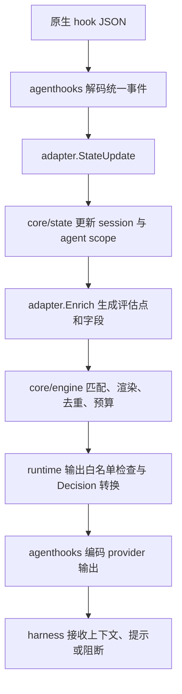

# STYLE 当前 adapter 实现总览

更新时间：2026-10-16。源码基线：`dd7438ec`。

本文总结当前仓库的实现，不代表 Claude Code / Codex 所有版本的完整产品能力。能力声明、安装配置、运行时可接收事件和真实验收结果分别说明；未修改现有 fallback 语义。

## 1. 范围与职责

STYLE 当前完整接入两个 provider：`codex` 和 `claude-code`。`agenthooks` 虽然还有其他 provider 的 codec / renderer，STYLE 尚未为它们提供完整 adapter 和 CLI 运行时接线。

| 层 | 负责内容 | 主要入口 |
|---|---|---|
| `agenthooks` | 原生输入解码、统一事件、工具/MCP/skill 识别、Decision 编码、hook 配置生成和 owner 合并 | [codec](../agenthooks/codec_codex.go)、[Claude codec](../agenthooks/codec_claudecode.go)、[install](../agenthooks/install/install.go) |
| `internal/adapter` | provider 检测、能力与数据来源声明、静态槽位、安装路线、原生数据补充 | [types.go](../internal/adapter/types.go) |
| `core/plan` | 根据规则需求和 adapter 事实选择投递位置，决定降级、跳过和安装错误 | [plan.go](../core/plan/plan.go) |
| `core/compile` | 把规划结果编译为 index 和静态正文 | [目录](../core/compile/) |
| `core/engine`、`core/state` | 匹配、渲染、去重、预算、会话和 agent 状态 | [engine](../core/engine/)、[state](../core/state/) |
| `internal/runtime` | 串起 codec、adapter、state、engine 和输出决策 | [runtime.go](../internal/runtime/runtime.go) |
| `internal/app` | 安装、卸载、sync/trust、路线选择、报告、CLI hook 入口 | [install.go](../internal/app/install.go)、[hook_command.go](../internal/app/hook_command.go) |

原则是 adapter 提供事实，core 决定策略。`core` 不导入 `agenthooks` 或 `internal/adapter`，由 [边界测试](../internal/adapter/boundary_test.go) 检查。

## 2. 公共接口与注册

[Definition](../internal/adapter/types.go) 将一个 provider 组装成以下部分：

| 接口或字段 | 作用 |
|---|---|
| `Detector.Detect` | 只读检测安装、版本与配置目录，返回 `Installation` |
| `PlanningFacts.Capability` | 某评估点是否支持 `add-context`、`system-message`、`deny` |
| `PlanningFacts.DataSource` | 某评估点能否提供条件/模板所需字段，记录来源与近似标记 |
| `PlanningFacts.BlindSpot` | 整条规则是否落入不可观测工具范围 |
| `PlanningFacts.StaticLocation` | `append` / `replace` 是否有可用静态槽位 |
| `StaticPositionProvider` | 列出具体安装的静态位置，供报告使用 |
| `Routes` | 安装路线及其优先级，声明顺序保留 |
| `Limits` | 原生输入限制、计量单位、是否近似和外部超限行为 |
| `Compact` | 压缩信号及其延迟执行属性 |
| `RuntimeEnricher.StateUpdate` | 将事件中的 model、effort、来源等转换成状态更新 |
| `RuntimeEnricher.Enrich` | 将统一事件转换为 `engine.Input` 和本次输入限制 |

`RuntimeEnricher` 单独定义，没有直接存入 `Definition`。CLI 的 `runHook` 按 provider 显式构造具体 `Enricher`；新增 provider 时也要补这一处接线。

[Registry](../internal/adapter/registry.go) 显式构造，没有全局自动注册。它校验 provider/route 名称、必需接口、限制单位与 compact 元数据；provider 枚举排序，route 顺序保留。`BuildPlanAdapter` 将丰富的事实接口投影成 `core/plan.Adapter` 的窄接口。

## 3. 检测、目录和安装路线

### 3.1 检测

| 项目 | Codex | Claude Code |
|---|---|---|
| 默认配置目录 | `$CODEX_HOME`，否则 `~/.codex` | `$CLAUDE_CONFIG_DIR`，否则 `~/.claude` |
| 可执行文件 | PATH 中的 `codex` | PATH 中的 `claude` |
| 版本读取 | `codex --version` | `claude --version` |
| 配置存在也可作为检测依据 | `config.toml` / `hooks.json` | `settings.json` / `CLAUDE.md` |

检测到配置不等于可执行文件可运行，版本也可能为空。`Installation` 只保存 provider、version、config dir，不保存凭据。

### 3.2 路线

| 路线 | 写入位置与用途 | 信任声明 |
|---|---|---|
| `codex-plugin` | 插件默认在 `$STYLE_HOME/adapters/codex/plugin`；包含插件清单、hook 和程序文件；静态指令及 hook 信任配置仍关联 Codex 配置目录 | `user-confirmation`，不会因文件存在就宣称已信任 |
| `codex-user` | Codex 配置目录的 `hooks.json` 和 `config.toml` | `preseed`，生成 hook 信任状态；配置满足安装检查时可报告 trusted |
| `claude-user` | Claude 配置目录的 `settings.json` 和 `CLAUDE.md` | `workspace`，`Status.Trusted` 保守返回 false，无法从配置文件推断工作区信任 |

Codex Definition 的声明顺序是 plugin、user；Claude 只有 user。实际选择还受显式路线参数、已安装锁定信息和可用性影响。项目级路线和 Claude 插件路线尚未实现。

Codex 插件的 marketplace 登记/启用尚未由 STYLE 自动完成；已有真实验收采用手动管理命令，不能把生成插件文件等同于 Codex 已加载插件。

### 3.3 文件生命周期

`Route` 提供 `Available`、`Trust`、`Plan`、`Apply`、`Remove`、`Status`。`Plan` / `Remove` 先返回可审阅的 `Changeset`，`Apply` 才写盘。

- `FileChange` 保存路径、根目录、Before/After、权限和删除信息；内容可能包含用户配置，不应直接写进日志。
- 复用 `agenthooks/install` 的 owner 合并、过期快照检查和文件写入；保留外部 handler 与托管区外的字节。
- owner 命名空间为 `style`，静态正文按包分组；卸载一个包后重新编译剩余包，最后一个包卸载时清除 STYLE 路线。
- Codex 的 `TransitionPlanner` 将旧路线移除和新路线生成合并，处理两条路线共享 `config.toml` 的情况。
- `InstallationBinder` 绑定实际配置目录和版本；`StorageBinder` 绑定选定的 `STYLE_HOME`，使 hook 使用安装时的 index/state。
- [HookCommand](../internal/adapter/command.go) 将 `./style` 等相对路径转成绝对路径；裸命令 `style` 仍交给 PATH 查找。

源码：[Codex route](../internal/adapter/codex/route.go)、[Claude route](../internal/adapter/claude/route.go)。

## 4. 注入点与输出能力

下表是 **STYLE adapter 的能力声明**。`C` 为给模型追加上下文，`U` 为给用户的 `systemMessage`，`D` 为阻断。

| STYLE 评估点 | Codex 原生入口 | Codex 能力 | Claude 原生入口 | Claude 能力 |
|---|---|---|---|---|
| `session.start` | `SessionStart` | C | `SessionStart` | C、U |
| `prompt.submitted` | `UserPromptSubmit` | C、U、D | `UserPromptSubmit` | C、U、D |
| `skill.explicit` | `UserPromptSubmit` 中识别 `$name` | C、U、D | `UserPromptExpansion` | C、U、D |
| `tool.pre` | `PreToolUse` | C、U、D | `PreToolUse` | C、U、D |
| `tool.post` | `PostToolUse` | C、U | `PostToolUse` | C、U |
| `tool.error` | 无 | 无 | `PostToolUseFailure` | C、U |
| `subagent.start` | `SubagentStart` | C | `SubagentStart`，仅观察 | 无 |

源码：[Codex Facts](../internal/adapter/codex/adapter.go)、[Claude Facts](../internal/adapter/claude/adapter.go)。

### 4.1 动作与能力的关系

- `inject` 需要 C，将正文交给模型。
- `warn` 使用 C 与 U；默认给模型的文本是正文第一句，也可用 `model_text`。只剩一个输出通道时，只有 `fallback: degrade` 允许部分输出。
- `block` 需要 D；工具阻断发生在执行前，prompt 阻断发生在提交入口。`tool.post` / `tool.error` 不声明阻断能力。
- `skill.explicit` 是 STYLE 合成评估点，规则应写 `target: skill`，不能直接写成 `target: event` 的 event 值。

### 4.2 能解码不等于会订阅，也不等于允许注入

`agenthooks` 的原生事件表比上表更大。`SessionEnd`、`Stop`、`SubagentStop`、`PreCompact`、`PostCompact` 等能被 codec 识别，不代表 STYLE 已为它们开放规则评估点。

两家 Enricher 都能把收到的 `PermissionRequest` 投影成 `tool.pre`，runtime 也注册了处理器，但正常安装不会额外订阅它。

Claude Enricher 能构造 `subagent.start` 评估点，但 Facts 不声明输出能力，codec 也只为 Codex 编码该事件的上下文。因此不能据此认为 Claude 子 agent 启动注入已实现。

### 4.3 订阅策略

**Codex 固定订阅五类事件**：`SessionStart`、`UserPromptSubmit`、`PreToolUse`、`PostToolUse`、`SubagentStart`。工具 matcher 固定为：

```regex
^(Bash|apply_patch|mcp__.*)$
```

包和规则在进程内过滤，新增包不改变固定 hook 定义的信任指纹。Manifest 将这些 hook 设置为同步执行，timeout 为 10 秒。

**Claude 按编译结果生成订阅**：`hooksForProvider` 从 index 推导原生事件与 matcher，再由 `Surface` 按 event+matcher 合并、去重和排序。工具、MCP、Skill 规则分别生成相应 matcher；全事件规则可使用空 matcher。

若已编译条目需要 `model`，额外订阅同步 `PostModelSwitch`。该事件只更新 session，不立即注入正文；下一评估点读取新 model 后再判断规则。`DefaultSurface` 只是缺少包专用请求时的默认集合，不代表每次安装都会订阅其中全部事件。

源码：[hooksForProvider](../internal/app/install.go)、两家 `adapter.go` 的 `Surface` / `HookManifest`。

## 5. 静态指令、动态 system 与 replace

| 项目 | Codex | Claude Code |
|---|---|---|
| 静态槽位名 | `developer_instructions` | `claude_md` |
| 实际载体 | 用户 `config.toml` 的根级 `developer_instructions` | 用户 `CLAUDE.md` 的 STYLE 托管块 |
| 支持模式 | `append` | `append` |
| `replace` 槽位 | 无 | 无 |

`target: system` 表示规则的常驻/会话级投递策略，不表示能替换原 agent 的底层 system prompt。`systemMessage` 是用户提示字段，也不是修改 system prompt 的接口。

### 5.1 静态规则

`action: inject`、正文静态、没有任何 `when` 的 system 规则，优先进入静态槽位。

- Codex 已有用户自有根级 `developer_instructions` 时，不声明可用静态槽位；不会覆盖或接管用户值。`fallback: degrade` 可改用动态投递。
- Claude 托管块标记损坏、重复、嵌套或文件不可读时，静态位置不可用；正常托管块更新保留用户正文。
- 静态位置不可用的 append 降级，先试 `session.start`，再试 `prompt.submitted` + session 去重，选一个位置。

### 5.2 动态 system

带运行时变量、条件或使用 warn 的 system 规则走动态评估。两点都可用时同时挂载 `session.start` 与 `prompt.submitted`，后者设 `reevaluate`；正文哈希去重避免重复投递，model/effort 变化导致正文变化时可补发。

只剩一个评估点时，`degrade` 可保留该点；完全没有可用位置时可能安装报错，缺失条件数据时也可能标记 `never-trigger`。因此不能把所有 target 的失败都概括为“degrade 最终跳过”。

### 5.3 replace 的当前结果

两家 adapter 均无 replace 槽位，动态追加也不能模拟替换。当前 `mode: replace` 的结果是：`degrade` / `skip` 跳过，`error` 拒绝安装。CLI 的 `--allow-replace` 只是授权检查，不会创造 adapter 没有的替换能力。

源码：[system.go](../core/plan/system.go)。

## 6. fallback：当前代码语义与缺口

默认值为 `degrade`。这些策略由 `core/plan` 实现，adapter 只返回事实。

| 策略 | 普通能力不足时的行为 |
|---|---|
| `degrade` | 尝试已实现的替代路径；并不保证降级成功，也不保证规则保留 |
| `skip` | 无法满足需求时跳过，不尝试替代事件或静态回退 |
| `error` | 普通评估分支无法满足需求时标记 fatal，使报告 blocked，阻止本次安装 |

### 6.1 当前降级路径

1. `tool` / `mcp` / `skill` 的 inject、warn：先试指定的 before/after，再试另一侧。
2. 两侧都不可用时，只有 inject、静态正文且 **没有任何 `when`** 的工具/MCP/skill 规则可退到带目标限定前缀的常驻静态指令；需有可用 append 槽位。
3. warn 缺一个通道时，degrade 保留另一个，状态为 `partial`；两个都没有则该评估点不可用。
4. block 缺 deny 时，degrade 在同一评估点尝试 warn，repeat 改为 every；不会改用另一侧工具事件或静态指令。
5. skill 同时规划隐式工具入口和显式入口。degrade 可以保留可用部分；skip 在存在普通能力失败时移除整条规则；error 因任一不可用部分阻止安装。
6. `target: event` 只有指定事件，没有自动替代事件，也不进入工具类静态回退。

### 6.2 Codex 的 tool.error 例子

```yaml
- id: on-tool-error
  target: event
  event: tool.error
  action: inject
  fallback: degrade
  text: 工具失败后先分析原因，再决定是否重试。
```

这条无条件规则在 Codex 下没有 add-context，也没有替代位置：

| fallback | 当前结果 |
|---|---|
| `degrade` | `skipped`，无 placement，其他规则可继续安装 |
| `skip` | `skipped`，无 placement |
| `error` | `install-error`，报告 blocked，安装中止 |

不会自动改到 `tool.post` 或常驻指令，因为这会改变“仅失败时触发”的含义。若条件还引用了该事件缺失的数据，非 error 策略可能先得到 `never-trigger`。

### 6.3 状态与特殊分支

规划状态包括 `native`、`degraded`、`partial`、`skipped`、`never-trigger`、`skipped-m2`、`install-error`。

`when.harness.name` 排除当前 adapter、`when.provider` 在 M1 不求值、`target: native` 留到 M2、工具盲区等分支，发生在普通 fallback 评估前。它们分别跳过或标记 never/M2；不能承诺 `fallback: error` 会拦住所有未生效规则。缺失条件数据与普通输出能力不足也有不同状态。

### 6.4 尚未统一的语义

- **degrade 是否允许丢弃**：现有代码允许，上文列的是当前行为。“降级不成功必须报错”尚未实施，不能当作既定约定。
- **tool.error 状态措辞**：规则规范写“Codex 上永不触发”，当前普通无条件规则实际是 `skipped`，并非 `never-trigger`。
- **静态回退条件**：运行时规范阶梯写“没有 `when.conditions`”，代码要求没有任何 `when`，更严格。
- **动态 system**：规范采用阶梯叙述，代码在两点均可用时双挂载；完全不可用时的静态回退描述也应结合代码重新统一。

这些是文档/策略待决点，本次总结没有更改实现或规范。源码：[requirements.go](../core/plan/requirements.go)、[events.go](../core/plan/events.go)、[policy.go](../core/plan/policy.go)、[plan.go](../core/plan/plan.go)；规范：[运行时 §5](../STYLE_DOCS/STYLE-spec-runtime.md)、[规则定义](../STYLE_DOCS/STYLE-spec-rules.md)。

## 7. 工具、MCP 和 skill 归一化

### 7.1 工具与可观测范围

Codex 固定订阅只观察 Bash、apply_patch 和 MCP。Facts 将 `shell`、`file.edit`、`mcp`、`*` 视为可观测 canonical selector；只有不可观测 selector 的工具规则标记为盲区。`*` 的覆盖仍受固定订阅范围限制。

Claude 可以按原生工具名生成 matcher，Facts 不声明固有工具盲区；这不保证任意拼写的工具名实际存在。canonical 工具名还需要通过安装层映射成原生 matcher。

### 7.2 MCP

MCP 复用工具 pre/post/error 入口，不增加独立原生事件。adapter 将调用归一成 `mcp.server` 和 `mcp.tool`；Claude 支持利用 payload 的 `mcp_server` 信息识别插件服务，避免仅靠工具名错误拆分。

### 7.3 skill

| 激活方式 | Codex | Claude Code |
|---|---|---|
| 显式 | 从 prompt 解析 `$name`，按首次出现顺序去重 | `UserPromptExpansion` 的 slash command，取 `command_name` |
| 隐式 | 识别 shell 读取本地 `skills/<name>/SKILL.md` | 识别原生 `Skill` 工具调用 |

隐式识别由 `agenthooks.SkillActivationOf` 提供，Enricher 把 skill 名放进工具评估点，engine 再按 skill selector 匹配。Codex 的本地读取识别覆盖 cat、sed -n、head、tail、bat 及带 cd 的支持形式，不是任意 shell 程序分析。

Codex 云端 skill 的真实工具路径尚未验证，不能把本地文件读取识别扩大为全部云端 skill 支持。源码：[Codex skill](../internal/adapter/codex/skill.go)、两家 `runtime.go`。

## 8. 运行时字段、model 和 effort

### 8.1 归一化字段

两家提供 model、effort/raw/approx、harness 名称与版本、cwd、permission mode、session/turn/agent 等公共事实；具体事件还提供：

| 事件类别 | 字段 |
|---|---|
| prompt | `prompt`；显式 skill 另有 `skill.name` |
| tool.pre | `tool.name`、`tool.canonical`、`tool.input`、嵌套 `tool.input.*`、`tool.added`、MCP/skill、cwd |
| tool.post / Claude tool.error | 上述工具字段，以及可用时的 `tool.output` |
| subagent.start | agent 身份等公共字段；输出能力仍受第 4 节限制 |

字段可用性声明表示 adapter 有提取路径，不保证每个 payload 都带值。条件缺值不匹配；模板缺值使用默认值或空文本。工具原文用于条件匹配，M1 校验禁止把工具输入/输出等事件内容直接放进模板。

对象/数组条件字段编码成稳定 JSON 文本，保留 `&`、`<`、`>`，不做 HTML 转义。`tool.added` 在 Codex 从 apply_patch 的新增行提取，在 Claude 从 Edit/Write 等支持的工具输入提取；不是所有工具都有该字段。

### 8.2 model

Codex 从事件的 model 更新状态。Claude 的 SessionStart model 与 PostModelSwitch 的 to_model 更新状态；model 缺失时不伪造新值，必要时保留已有值。启动时 unknown 的边界在真实验收中保留。

### 8.3 Codex effort

读取的是配置请求值，不是 hook 中实时报告的实际推理强度。解析顺序为：

1. 祖先进程启动参数中的 `-c model_reasoning_effort=…`。
2. 明确受信工作目录下 `.codex/config.toml`（生产未知信任时跳过）。
3. `-p` 指定的 `CODEX_HOME/<name>.config.toml`。
4. 用户 `config.toml` 的顶层值。

以上为实测 Codex 0.159.3 的顺序；缺失 profile 文件继承用户配置，新版拒绝 legacy profile selector/选中 table。旧/未知版本保留表式 profile 兼容解析。本轮真实 CLI 配置请求由本地 sink 记录，不等同远端模型投递。

每会话解析一次，即使没有值也标记 resolved；不会每个工具 hook 重读。`plan_mode_reasoning_effort` 不读取，会话中途通过 `/model` 改 effort 的检测未实现。

**生产接线边界**：Enricher 提供 `ProjectTrusted` 回调，但当前 `runHook` 没有设置它，默认不读项目配置。测试可注入明确的信任判断；不能将可注入能力写成生产已经自动识别项目信任。

### 8.4 Claude effort 与映射

每个事件按 `effort.level` → `CLAUDE_EFFORT` → 已存 session 的优先级解析。上层报告未知值时保留 raw，不回退到旧的已知档位；状态清除旧 tier/approx，避免误匹配。

| provider | exact 映射 | alias |
|---|---|---|
| Codex | none、minimal、low、medium、high、xhigh、max | ultra → max |
| Claude | low、medium、high、xhigh、max | 无 |

映射大小写不敏感，保留原始拼写。已知 exact/alias 的 `thinking_effort_approx=false`；未知值没有 canonical tier 和 approx，不伪造强度。Claude 当前不产出 none/minimal；关闭思考如何表示仍待真实验证。

源码：[Codex effort](../internal/adapter/codex/effort.go)、[Claude effort](../internal/adapter/claude/effort.go)、[effortmap](../internal/adapter/effortmap/effortmap.go)。

## 9. 事件到模型输入的链路



安装生成的入口形如 `style … agenthooks run --provider=codex` 或 `--provider=claude-code`，携带 STYLE home、harness home 和版本。运行时读取 `$STYLE_HOME/build/index.json` 与 `$STYLE_HOME/state`；不重新读取规则源码来执行。

- `StateUpdate` 后先更新会话和 scope，再调用 `Enrich`；一次 prompt 可生成普通 prompt 和多个显式 skill 评估点。
- 原生 turn ID 优先，缺失时用 scope 的 prompt_count 作为回合标识。
- 默认普通规则作用于主 agent；显式 agent 条件可覆盖。去重区分 session、agent scope、generation/epoch 和正文哈希。
- repeat 支持 every、turn、session；block 与 subagent.start 不按普通规则去重。
- 压缩通过 `SessionStart(source=compact)` 识别，两家 Definition 均标记 deferred。补发由 state/engine 和 `reinject_on_compact` 控制，不是独立 PostCompact 注入。

源码：[runtime](../internal/runtime/runtime.go)、[Codex Enricher](../internal/adapter/codex/runtime.go)、[Claude Enricher](../internal/adapter/claude/runtime.go)。

## 10. 输出、失败策略和限制

### 10.1 输出白名单

STYLE 的模型上下文编码到 `hookSpecificOutput.additionalContext`，用户提示编码到顶层 `systemMessage`。prompt block 使用 `decision: block` / `reason`；tool pre block 使用 `permissionDecision: deny` / reason。

Claude 的 UserPromptSubmit 阻断可带嵌套 `suppressOriginalPrompt`，其他事件和 Codex 不使用这个字段。STYLE 不开放底层 codec 的全部能力，例如工具参数重写、结果替换、allow/ask 决策。

无操作时 Codex stdout 为空，Claude 输出 `{}`。engine 和 codec 两层约束输出，golden 另有白名单检查。

### 10.2 fail-open / fail-closed

默认 index 加载、state、enrich、engine 等处理错误走 fail-open，记录不含正文的错误信息。规则命中的 `block` 与“运行时异常时是否关闭”是两件事。

只有 Claude 支持当前 CLI 的 fail-closed 选项。安装器仅对 blocking PreToolUse 配置 `--fail-closed` 和 `onFailure: block`，要求检测到 Claude Code ≥ 2.1.295；版本未知或不足时拒绝该配置。Codex 明确拒绝 fail-closed。不要把这一机制理解成所有事件都能强制中止 agent。

### 10.3 输入上限与预算

| provider | adapter 默认限制 | 声明性质 | 外部超限行为枚举 |
|---|---|---|---|
| Codex | 2500 token | approximate=true | file-preview |
| Claude | 10000 字符 | approximate=false | file-preview |

这里是项目采用的原生限制事实，不是本次重新测得的所有 harness 版本保证。真实超限表现仍有待测项。

`core/tokens` 单独计算 per_rule、per_event、always_on 和跨包预算；单位不可混用。运行时按本次事件合并后的模型文本检查输入限制，超限从排序末尾丢弃整条候选并释放去重占位，不从正文中间截断。用户提示不是模型文本预算本身。

日志/stats 保存规则 ID、point、action、result、正文 hash 和估算 token 等元数据，不保存 prompt、工具正文或渲染全文。

## 11. CLI 报告和已有验证

常用只读入口：

```sh
style adapters --json
style plan example/terse-reviewer --harness codex
style plan example/terse-reviewer --harness claude-code
style doctor
```

`adapters` 列出检测目录/版本、各路线状态与信任、能力、字段、静态槽位和限制。单个 provider 的检测失败作为报告数据，不隐藏其他 provider。`doctor` 结合已安装 lock 检查实际安装根、配置/index/包漂移、路线、信任边界和运行环境。

### 11.1 离线验证

- 两家 adapter 单元测试：能力、检测、路线、静态字节往返、effort、skill 和字段归一化。
- conformance：46 个原生 payload 的统一事件/评估点和 wire golden，含 no-op、阻断、MCP、skill、subagent、未知事件。
- effort：25 组 fixture 经过 runtime，并核对嵌入映射表覆盖。
- 路线往返：Plan 无写入、Apply、幂等、Remove 后恢复外部字节和权限。
- 真实构建 CLI 处理所有 wire golden，及生成命令的 hook 入口验证。
- core 导入边界、输出白名单、agent scope 和规划/token 报告 golden。

本次文档核对使用的回归命令：

```sh
env -u CODEX_HOME -u CODEX_SANDBOX \
  GOPATH=/tmp/style-cli-gopath \
  GOMODCACHE=/tmp/style-cli-gomodcache \
  GOCACHE=/tmp/style-cli-gocache \
  go test -count=1 ./internal/adapter/... ./internal/runtime ./core/plan ./internal/app
```

这组测试验证当前实现；不表示本次新增了 tool.error 专用回归，也不替代真实 harness 验收。

### 11.2 已有真实证据的范围

项目记录的实测版本为 Codex 0.159.3、Claude Code 2.1.300。M1b 的 B/C 条目已按测试矩阵声明范围通过，不代表设计 §15 的所有未决项都关闭。

- Codex 上下文投递以 rollout 中 `hooks.additional_context` 为证；U7 验证 spawn_agent 的子线程收到 subagent.start 上下文，父线程没有该注入。
- Codex compact 后 developer_instructions 可见；compact 来源的 SessionStart 延迟到下一回合开始执行。
- Claude 模型切换和动态补发有真实证据；启动 model/effort unknown 边界保留。
- Claude systemMessage 只确认 PreToolUse 的用户可见性；其他事件的能力仍属当前声明。
- Claude 性能验收按整批 hook 样本 p95 口径通过，不能扩大为每类事件均达标。CR-05 的 state 优化已有离线计时，真实 harness 计时尚未复测。

完整证据见 [测试矩阵](STYLE-M1-TESTS.md)、[进度日志](PROGRESS.md)、[M1b 手册](STYLE-M1B-MANUAL.md)、[设计 §15](../STYLE_DOCS/STYLE-cli-design.md)。

## 12. 已知边界与后续工作

| 类别 | 当前边界 |
|---|---|
| fallback | degrade 可最终丢弃；tool.error 状态措辞与规范不统一；严格降级语义尚未定案 |
| system prompt | 两家都只追加；不能替换原 agent 底层 system prompt；replace 无槽位 |
| Codex 工具 | 固定订阅盲区仍存在，不能把 canonical `*` 当成原生全工具覆盖 |
| Codex effort | 配置请求值、每会话一次；生产未注入项目信任回调；profile/项目信任真实组合覆盖不完整 |
| Codex plugin | marketplace 登记/启用没有自动化 |
| Codex skill / 子 agent | 云端 skill 未测；U7 未覆盖嵌套子 agent、fork 启动和子 agent 内工具规则 |
| Claude | workspace trust 无法自动确认；hook 热更新未测；思考关闭的 effort 表示未测；多数事件的 systemMessage 用户显示未测 |
| 成本与超限 | token 校准、典型会话成本、真实超限表现和提示词缓存细节仍有未决项 |
| 路线与 provider | 项目级路线、Claude 插件路线、其他 STYLE provider adapter 尚未实现 |
| 未来能力 | native、Claude rules 静态位置、output style replace、provider 条件等按 M2/M3/M4 backlog 规划 |

后续若要改变 degrade 的保证，应先统一规范语义、各 target 的失败收尾、状态报告与测试，再修改规划器；本文件只记录当前状态。
